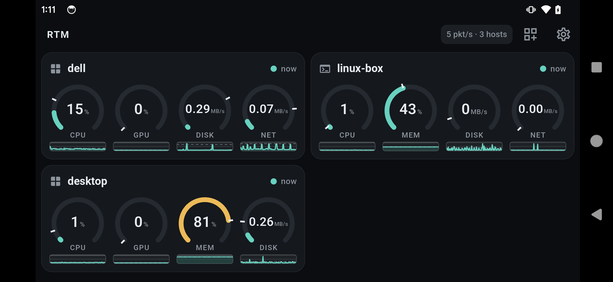

# Remote Task Manager (rtm)

Turn a spare Android (or iOS) phone into a live task-manager side screen for several PCs at once.



*Three hosts live on one phone: dials with 5 s peak hold and sparklines. Other layouts: bars, bar tiles, line graphs.*

```
 ┌─ PC 1 (Linux) ──┐   UDP broadcast / UDP unicast / TCP   ┌─ phone ─────────────┐
 │ rtm-sender      │ ───────── JSON, 1 packet/interval ───▶ │ RTM Viewer          │
 └─────────────────┘                                        │  ┌───────────────┐  │
 ┌─ PC 2 (Windows) ┐                                        │  │ workstation   │  │
 │ rtm-sender      │ ─────────────────────────────────────▶ │  │ CPU GPU MEM DISK │
 └─────────────────┘                                        │  └───────────────┘  │
                                                            │  ┌───────────────┐  │
                                                            │  │ gaming-pc     │  │
                                                            │  └───────────────┘  │
                                                            └─────────────────────┘
```

* **`sender/`** Rust daemon for Linux and Windows (macOS compiles, GPU/autostart stubs). Samples
  CPU, GPU, memory and disk activity every 1 / 5 / 15 / 30 s and sends JSON packets by UDP broadcast
  (default), UDP unicast and/or TCP unicast. Optional tray icon + settings window (`--features gui`).
* **`viewer/`** Flutter app for Android and iOS, portrait and landscape, phones and tablets. Listens on
  UDP and TCP port 48000, shows one card per host with gauges and sparklines. New metrics from a
  sender appear automatically; reorder, hide or restyle them in Settings.
* **`protocol/`** the JSON wire format, JSON Schema and golden example packets shared by both sides.

Wire format: [`protocol/PROTOCOL.md`](protocol/PROTOCOL.md). Sender details: [`sender/crates/rtm-sender/README.md`](sender/crates/rtm-sender/README.md).

## Quick start

### 1. Sender on each PC

Download from the latest [release](../../releases/latest):

| Asset | For |
|---|---|
| `rtm-sender-linux-x86_64` | Linux servers and desktops without a tray: headless, no GTK or display needed |
| `rtm-sender-gui-linux-x86_64` | Linux desktops: tray icon + settings window. Needs GTK 3 and libayatana-appindicator3 installed, even when run with `--no-gui` |
| `rtm-sender-windows-x86_64.zip` | Windows: `rtm-sender.exe` (tray + settings) with `install.bat` / `uninstall.bat` |
| `rtm-sender-windows-x86_64.exe` | Windows: the same exe on its own (run it in place) |
| `rtm-sender-setup.exe` | Windows: Inno Setup installer for the same exe (per-user or all users, optional start at login) |
| `SHA256SUMS` | SHA-256 of every asset: `sha256sum -c SHA256SUMS --ignore-missing` |

Or build (Rust stable: 1.89+ headless, 1.95+ for the GUI):
```
sender\build.bat            # Windows: tray + settings build -> dist\windows-x86_64\rtm-sender.exe (+ install.bat, uninstall.bat)
sender/build.sh             # Linux/macOS: same -> dist/<os>-<arch>/rtm-sender
sender/build.sh headless    # either script: add "headless" for the no-GUI daemon, "debug" for a debug build
```
or by hand:
```
cd sender
cargo build --release -p rtm-sender                 # headless, no system deps
cargo build --release -p rtm-sender --features gui  # tray + settings window; Linux needs the libs below
```
Linux GUI build deps: `sudo apt install libgtk-3-dev libayatana-appindicator3-dev libxdo-dev libxkbcommon-dev`.

Run:
```
rtm-sender                       # broadcasts on all LAN interfaces every 1 s
rtm-sender --interval 5s         # 100ms | 200ms | 1s | 5s | 15s | 30s (any value 100 ms .. 1 h)
rtm-sender --once                # print one packet as JSON and exit (for testing)
rtm-sender --tcp-unicast 192.168.1.50:48000   # phone on another subnet, or Wi-Fi that drops broadcast
rtm-sender --print-config        # show the effective config and where the file lives
```
Config file (created on first run, hot-reloaded on save):
Linux `~/.config/rtm/sender.toml`, Windows `%APPDATA%\rtm\sender.toml`. Every key is commented in the generated file;
see `sender/crates/rtm-sender/README.md` for details.

Install on Windows: `dist\windows-x86_64\install.bat` (per-user, no admin) or `install.bat /system`;
or run `rtm-sender-setup.exe` (built from `packaging/windows/rtm-sender.iss` with Inno Setup). Linux: `packaging/README.md` has the
systemd user unit. Or tick "Start at login" in the GUI settings on either OS (it shows the installer's registration too).

Only one sender runs per config file: a second copy exits with "already running" (exit code 3).
The tray build also logs to `sender.log` next to `sender.toml` (tray menu → "Open log file"); on Windows
a start-up error is shown in a message box.

### 2. Viewer on the phone

Install the debug APK from the latest CI run (`rtm-viewer-debug.apk` artifact) or build it:
```
cd viewer
flutter pub get
flutter build apk --debug          # build/app/outputs/flutter-apk/app-debug.apk
adb install -r build/app/outputs/flutter-apk/app-debug.apk
```
Open RTM Viewer. With the phone on the same Wi-Fi as the PCs, hosts appear within one interval.
Nothing to configure. Settings lets you change ports, add a shared secret, switch TCP listening,
reorder metrics, pick gauge/bar/sparkline/number per metric, and keep the screen awake (on by default).

iOS: `flutter build ios` on a Mac; `NSLocalNetworkUsageDescription` is already set.

### 3. No hosts showing up?

| Symptom | Fix |
|---|---|
| Phone shows "Listening on UDP 48000 … no hosts yet" | Check both devices are on the same Wi-Fi/LAN. Guest and IoT SSIDs often block broadcast: add the phone's IP to the sender's `tcp_unicast` (or `--tcp-unicast ip:48000`) |
| Linux listener gets nothing | ufw blocks inbound by default: `sudo ufw allow 48000/udp` and `48000/tcp` |
| Host card is grey | No packet for 3 intervals; after max(30 s, 6 intervals) it collapses to "offline" |
| GPU gauge shows a dash | Utilisation not readable (Intel iGPU on Linux needs root; frequency is shown in the details) |
| Packets rejected with "auth" error | Shared secret differs between sender config and viewer settings |

Dev helpers in `tools/`: `fake-sender.py` emits three synthetic hosts for UI work; `udp-listen.py`
prints what a listener hears.

## Adding a metric

1. Sender: implement the `Collector` trait in `sender/crates/rtm-collect` (one small struct), register
   its id, add the id to `[metrics].enabled`. Done.
2. Viewer: nothing. It appears as a gauge (unit `%`) or a number tile on first sight.
3. Optional: add the key to the well-known table in `protocol/PROTOCOL.md`.

## Development

```
cd sender && cargo fmt --all --check && cargo test --workspace && cargo clippy --workspace --all-targets -- -D warnings
cd sender && cargo test -p rtm-sender --features gui && cargo clippy -p rtm-sender --all-targets --features gui -- -D warnings
cd viewer && dart format --output=none --set-exit-if-changed lib test && flutter analyze && flutter test
```
CI (`.github/workflows/ci.yml`) runs all of these on every branch push (Linux + Windows for the
sender, with and without `gui`) and uploads the sender binaries and the debug APK. Tags `v*` publish
the release assets listed above plus `rtm-viewer.apk` and `SHA256SUMS` (`release.yml`), once every build has succeeded.

License: MIT.

## Attribution

Designed and built with Anthropic's Claude models through Claude Code: Claude Fable 5.1 led the
design, planning and integration, and Claude Opus implemented the sender crates, the viewer,
and the follow-up fixes as sub-agents.
